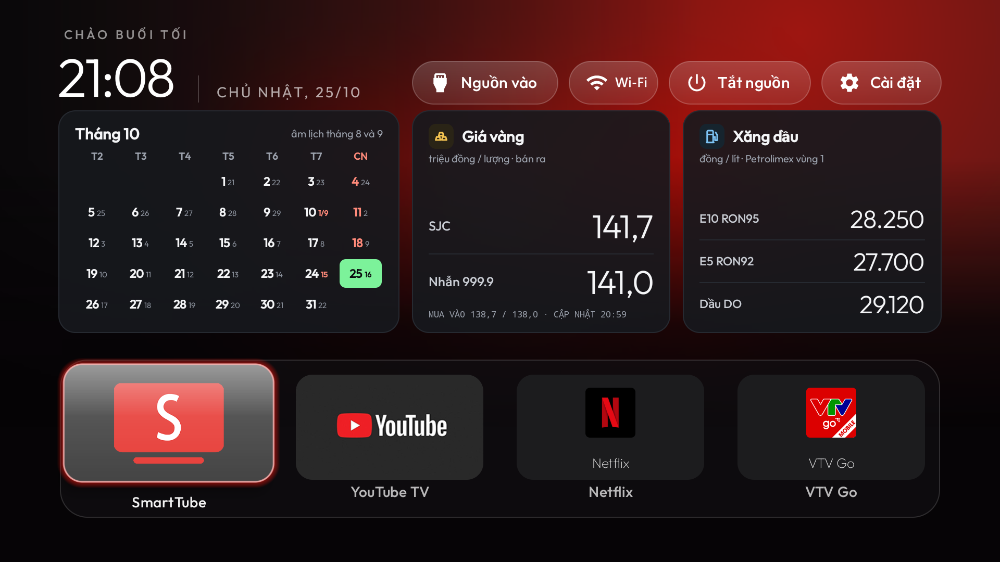
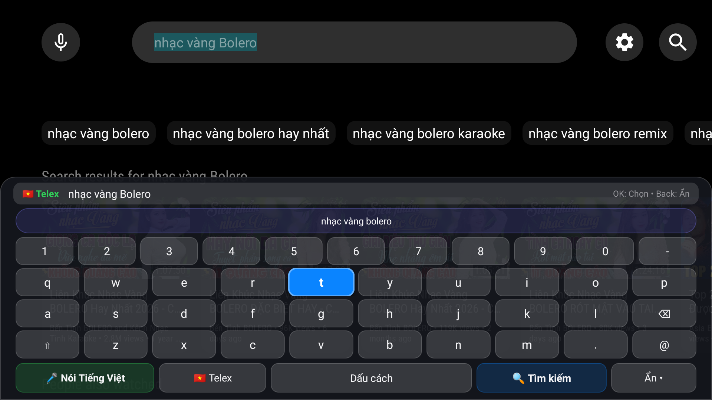
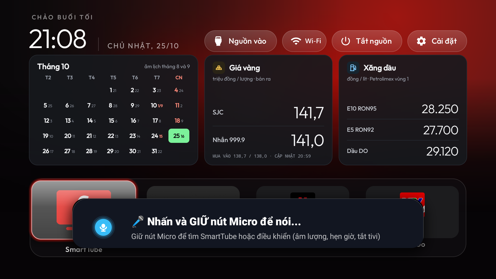
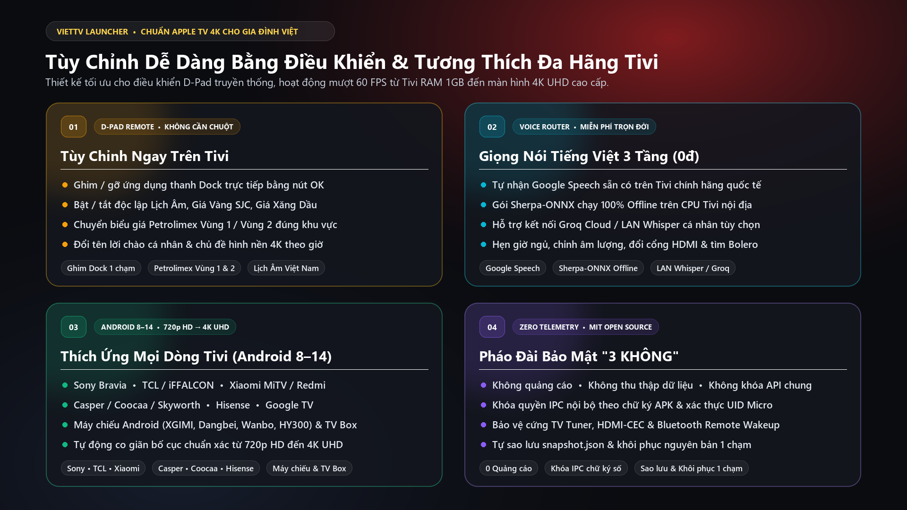

# 📺 VietTV Launcher (`vn.viettv.launcher`)

> **Giao diện Apple TV 4K Tiếng Việt siêu mượt, Bàn phím Telex D-Pad, Giọng nói Rảnh tay Offline & Trình tối ưu RAM đa hãng cho mọi Android TV · Google TV · Tivi nội địa Trung Quốc.**

[](https://github.com/daiduong1990/VietTV/actions/workflows/build-release.yml)
[](LICENSE)
[-blue.svg)](launcher/app/src/main/AndroidManifest.xml)
[-gold.svg)](SECURITY.md)

---

## 🖼️ Hình Ảnh Thực Tế Trên Tivi

| Màn hình chính Apple TV 4K & Lịch Âm · Giá Vàng · Giá Xăng | Bàn phím Tiếng Việt Telex D-Pad & Gợi ý Tìm kiếm 1 chạm |
|:---:|:---:|
| <br><sub>Giao diện kính mờ 60 FPS, Lịch Âm Việt Nam, Giá Vàng SJC & Xăng Petrolimex trực tiếp</sub> | <br><sub>Gõ dấu Telex tự nhiên bằng điều khiển từ xa kèm hàng từ khóa gợi ý thông minh</sub> |
| **Trợ lý Giọng nói Tiếng Việt Rảnh tay (`TvVoiceCommandRouter`)** | **Tùy chỉnh Bằng Điều khiển & Tương thích Đa hãng Tivi** |
| <br><sub>Giữ nút Micro để tìm SmartTube/YouTube, hẹn giờ ngủ, chỉnh âm lượng hoặc đổi cổng HDMI</sub> | <br><sub>Tùy chỉnh trực tiếp trên Tivi, giọng nói 3 tầng miễn phí & kiến trúc bảo mật 3 KHÔNG</sub> |

---

## ✨ Điểm Nổi Bật Dành Riêng Cho Gia Đình Việt

- 🎨 **Giao diện phong cách Apple TV 4K siêu nhẹ**: Tốc độ phản hồi tức thì ở 60 FPS ngay cả trên Tivi RAM 1GB–2GB, hình nền 4K tự động theo khung giờ sáng/chiều/đêm, hỗ trợ màn hình chờ đồng hồ (`ClockDream`).
- ⌨️ **Bàn phím Tivi Tiếng Việt Telex D-Pad tích hợp sẵn (`VnTvImeService`)**: Bấm điều khiển dễ dàng, gõ dấu Telex tự nhiên (`s, f, r, x, j, aa, aw, ee, oo, ow, uw, dd`) kèm gợi ý cụm từ tìm kiếm phim/nhạc/karaoke phổ biến một chạm.
- 🎙️ **Khẩu lệnh Giọng nói Tiếng Việt Rảnh tay & Hẹn giờ ngủ (`TvVoiceCommandRouter`)**: Giữ nút Micro trên điều khiển để hẹn giờ tắt Tivi, chỉnh âm lượng, chuyển cổng HDMI 1/2/3/AV, mở ứng dụng hoặc tìm nhạc Bolero / Karaoke thẳng vào **SmartTube** / **YouTube**.
- 🧠 **Giọng nói Tiếng Việt 100% Offline trên CPU Tivi (Miễn phí trọn đời)**: Tích hợp trình cài đặt 1 chạm gói nhận diện giọng nói mã nguồn mở **K2-FSA Sherpa-ONNX Zipformer Tiếng Việt** chạy trực tiếp trên chip `arm64-v8a` / `armeabi-v7a` — cứu cánh hoàn hảo cho Tivi Xiaomi / máy chiếu nội địa bị cắt dịch vụ Google!
- 🇻🇳 **Bảng Thông Tin Đời Sống Việt Nam Trực Tiếp**:
  - **Lịch Âm - Dương Việt Nam** chính xác kèm lễ Tết truyền thống.
  - **Thời tiết địa phương** theo thời gian thực.
  - **Giá Vàng SJC / Nhẫn PNJ** & **Giá Xăng Dầu Petrolimex (hỗ trợ chọn Vùng 1 / Vùng 2)**.
- 🧹 **Tối ưu RAM Đa Hãng An Toàn Tuyệt Đối (`BRAND_PROFILES`)**: Tự động nhận diện phần cứng **Xiaomi MiTV, Sony Bravia, TCL / iFFALCON, Casper / Coocaa / Skyworth, Máy chiếu Android (XGIMI, Dangbei, Wanbo, HY300)** và **TV Box**, tự sao lưu `.backups/<thiet-bi>/snapshot.json` trước khi đóng băng quảng cáo và khôi phục nguyên bản chỉ với 1 cú nhấp chuột!

---

## 🚀 Hướng Dẫn Cài Đặt Cực Dễ (2 Cách)

### Cách 1: Không cần máy tính — Cài qua USB hoặc ứng dụng *Send Files to TV* (1 phút)

Phù hợp cho mọi Tivi chính hãng (Sony, TCL, Casper, Xiaomi Quốc tế, Chromecast, TV Box):

1. Tải file **`VietTV-Launcher.apk`** mới nhất tại mục **[Releases](../../releases)**.
2. Chép vào USB cắm lên Tivi **hoặc** dùng ứng dụng **Send Files to TV** / **LocalSend** bắn từ điện thoại sang Tivi rồi bấm **Cài đặt (Install)**.
3. Mở **VietTV Launcher**:
   - Bấm nút **Cài đặt** ngay trên giao diện chính để chọn **VietTV làm Màn hình chính**, bật **Bàn phím Tiếng Việt Telex**, chọn **Vùng 1 / Vùng 2** cho bảng giá xăng Petrolimex và tùy chỉnh thanh **Dock** ứng dụng yêu thích hoàn toàn bằng điều khiển Tivi!

---

### Cách 2: Tối ưu toàn diện bằng máy tính — 1 cú nhấp chuột (`CAI_DAT_NHANH.bat`)

Phù hợp khi bạn muốn **dọn sạch ứng dụng rác/quảng cáo ngầm giải phóng ~500MB–1GB RAM**, **mở khóa nút Home / nút Micro vật lý trên Tivi nội địa Trung Quốc**, biên dịch tăng tốc **ARM Native AOT** và cài **Giọng nói Tiếng Việt Offline**:

1. **Trên Tivi**: Vào *Cài đặt (Settings) -> Giới thiệu (About) -> bấm 7 lần vào Bản dựng (Build)* để mở *Tùy chọn nhà phát triển (Developer options)* -> Bật **Gỡ lỗi USB / Gỡ lỗi qua mạng (ADB Debugging)**. *(Đảm bảo Tivi và máy tính chung mạng Wi-Fi/LAN)*.
2. **Trên máy tính** (cài sẵn [Node.js 18+](https://nodejs.org/) — **không** cần cài Android Studio hay ADB thủ công, công cụ sẽ tự tải bản chuẩn của Google):
   - **Windows**: Nhấp đúp mở file **`CAI_DAT_NHANH.bat`**
   - **macOS / Linux**: Mở Terminal chạy `./cai_dat_nhanh.sh`
3. Chọn số trên menu Tiếng Việt thân thiện:
   - **`1`** — Tự tìm Tivi trong mạng Wi-Fi & Cài trọn bộ Giao diện + Bàn phím Telex + Tối ưu RAM an toàn theo hãng.
   - **`2`** — Chỉ cài Giao diện & Bàn phím Tiếng Việt Telex.
   - **`3`** — Cài thêm Gói Giọng Nói Tiếng Việt Offline (`Sherpa-ONNX`) chạy trực tiếp trên CPU Tivi.
   - **`4`** — Khôi phục Tivi về nguyên bản 100% từ file sao lưu tự động.
   - **`5`** — Mở lại cập nhật hệ thống OTA (khi muốn nâng cấp firmware hãng).
4. Lần đầu kết nối, màn hình Tivi sẽ hiện bảng hỏi quyền gỡ lỗi: cầm điều khiển tích chọn **"Luôn cho phép từ máy tính này (Always allow)"** -> bấm **OK**.

---

## 🎙️ Bảng Khẩu Lệnh Giọng Nói Tiếng Việt Rảnh Tay

Giữ nút **Micro** trên điều khiển (hoặc bấm biểu tượng Tìm kiếm Giọng nói) và nói tự nhiên:

| Nhóm tính năng | Ví dụ câu nói tự nhiên | Hành động thực thi |
|---|---|---|
| **Hẹn giờ ngủ thông minh** | *"Hẹn giờ tắt 30 phút"*, *"Hẹn giờ 1 tiếng rưỡi"*, *"Hủy hẹn giờ"* | Tự đếm ngược ngầm và đưa Tivi về chế độ nghỉ đúng giờ |
| **Tắt màn hình / Đi ngủ** | *"Tắt tivi"*, *"Đi ngủ thôi"* | Tắt màn hình chờ (Standby) ngay lập tức |
| **Điều chỉnh âm lượng** | *"Âm lượng 15"*, *"To lên"*, *"Nhỏ xuống"*, *"Tắt tiếng"*, *"Mở tiếng"* | Tăng/giảm hoặc đặt chính xác mức âm lượng hệ thống |
| **Chuyển nguồn vào (Input)** | *"Mở HDMI 1"*, *"Chuyển sang HDMI 2"*, *"HDMI 3"*, *"Cổng AV"* | Chuyển thẳng sang đầu thu truyền hình, PS5, PC, đầu Karaoke |
| **Mở nhanh ứng dụng / Wi-Fi** | *"Mở VTV Go"*, *"Mở Netflix"*, *"Mở cài đặt mạng Wi-Fi"* | Khởi chạy ngay ứng dụng hoặc màn hình cài đặt Wi-Fi |
| **Tìm kiếm Video / Karaoke** | *"Nhạc vàng Bolero"*, *"Karaoke nhạc trẻ"*, *"Thời sự VTV1 hôm nay"* | Định tuyến thẳng kết quả vào **SmartTube** hoặc **YouTube TV** |

---

## 🎮 Tùy Chỉnh Trực Tiếp Bằng Điều Khiển Tivi (D-Pad)

- **Ghim / Sắp xếp ứng dụng trên thanh Dock**: Di chuyển tới ô ứng dụng -> **Nhấn giữ nút OK (Select)** hoặc bấm nút **Menu** trên điều khiển để ghim lên thanh Dock, đổi vị trí hoặc mở kho tất cả ứng dụng.
- **Đổi giao diện & Hình nền 4K**: Vào nút **Cài đặt Giao diện** góc trên màn hình chính để chọn chủ đề (*Mặc định, Aurora, Phong cảnh 4K theo giờ, 6 Cột...*).
- **Chuyển đổi Giá Xăng Vùng 1 / Vùng 2**: Bật/tắt bảng thông tin Giá Vàng - Giá Xăng và chọn đúng khu vực sinh sống (**Vùng 1** hoặc **Vùng 2** theo biểu giá Petrolimex) ngay trong mục Cài đặt.
- **Gõ Tiếng Việt trên Bàn phím Telex**: Hỗ trợ đầy đủ phím điều hướng 4 chiều, hàng từ gợi ý thông minh trên đầu bàn phím và nút đọc chính tả bằng giọng nói.

---

## 📱 Bảng Tương Thích & Thích Ứng Đa Thiết Bị

| Nhóm thiết bị | Dòng máy / Hãng tiêu biểu | Hệ điều hành & Độ phân giải | Tính năng thích ứng chuyên biệt |
|---|---|---|---|
| **Tivi Chính hãng Quốc tế** | **Sony Bravia**, **TCL / iFFALCON**, **Casper**, **Coocaa**, **Skyworth**, **Hisense**, **Chromecast Google TV** | Android TV / Google TV **8.0 – 14** (`720p HD` · `1080p FHD` · `4K UHD`) | Tự động dùng Google Speech sẵn có, giữ nguyên cấu hình Private DNS, HDMI-CEC (Bravia Sync / T-Link) và nút kênh TV Tuner |
| **Tivi & Máy chiếu Nội địa Trung Quốc** | **Xiaomi MiTV**, **Redmi TV**, **XGIMI**, **Dangbei**, **Wanbo**, **JMGO**, **HY300 / HY320** | Android / PatchWall / MIUI TV **8.0+** (`720p HD` · `1080p FHD` · `4K UHD`) | Mở khóa nút Home & nút Micro vật lý, cài 1 chạm gói **Sherpa-ONNX Tiếng Việt Offline** trên CPU khi bị cắt dịch vụ Google, bảo toàn Bluetooth Wakeup |
| **Android TV Box AOSP** | **Mi Box S / 4K**, **TX3 Mini**, **X96 Max**, **Mecool**, **H96 Max** | Android TV / AOSP **8.0 – 14** (`720p HD` · `1080p FHD` · `4K UHD`) | Giao diện siêu nhẹ mượt **60 FPS** ngay cả trên phần cứng RAM 1GB–2GB, biên dịch tăng tốc ARM Native AOT cho ứng dụng xem phim |

---

## 🛡️ Cơ Chế Bảo Mật "3 KHÔNG" & An Toàn Phần Cứng

1. **KHÔNG Quảng cáo · KHÔNG Thu thập dữ liệu**: Mã nguồn mở hoàn toàn theo giấy phép MIT, không gửi bất kỳ dữ liệu cá nhân hay lịch sử xem Tivi về máy chủ trung gian.
2. **KHÔNG Khóa API dùng chung**: Không nhúng khóa API đám mây dùng chung trong APK (loại bỏ hoàn toàn nguy cơ hết hạn mức đột ngột hoặc lộ dữ liệu âm thanh). Hoạt động độc lập với bộ nhận diện của hệ thống hoặc gói **Sherpa-ONNX Offline** miễn phí.
3. **KHÔNG Xóa mù quáng gói hệ thống**:
   - Danh sách bất biến **`UNIVERSAL_PROTECTED_PACKAGES`** bảo vệ tuyệt đối trình dò kênh TV Tuner, HDMI-CEC (Bravia Sync / T-Link), Bluetooth Wakeup đánh thức điều khiển từ xa, SystemUI, Google Katniss/TTS và toàn bộ ứng dụng xem phim (SmartTube, YouTube, Netflix, VTVgo, FPT Play, VieON, TV360).
   - **Chỉ tắt Private DNS trên dòng `MiTV-*` nội địa** (không bao giờ can thiệp cấu hình DNS của Sony, TCL, Casper hay Google TV quốc tế).
   - Mọi thao tác tối ưu đều tạo bản sao lưu `.backups/<thiet-bi>/snapshot.json` riêng cho từng chiếc Tivi trước khi thực hiện.

---

## 🛠️ Dành Cho Lập Trình Viên (Build từ Mã Nguồn & Kiểm Thử)

Kho mã nguồn **không dùng bất kỳ thư viện npm bên ngoài nào** (`0 dependencies`), chỉ sử dụng thư viện chuẩn của Node.js >= 18:

```bash
# Chạy kiểm tra bảo mật Zero-PII/Secret, kiểm tra an toàn đa hãng & Unit Tests (Node + JDK 17)
npm test

# Tự động tải JDK 17 / Android SDK 34 (nếu máy chưa có) và biên dịch dist/VietTV-Launcher.apk + SHA-256
npm run build:apk

# Quét tự động các Tivi đang mở ADB trong mạng LAN (/24 cổng 5555)
npm run discover

# Mở trình hướng dẫn tương tác Tiếng Việt
npm start
```

---

## 🌐 English Overview

**VietTV (`vn.viettv.launcher`)** is a clean, open-source, 60 FPS Apple TV-inspired home launcher, D-Pad Vietnamese Telex Input Method (`VnTvImeService`), hands-free voice command router (`TvVoiceCommandRouter`), and multi-brand safe optimizer for Android TV, Google TV, and Chinese stock ROM TVs.

### Key Highlights
- **Zero-Dependency Pure Node.js Tooling (`tools/viettv.js`, `scripts/build_apk.js`)**: Auto-discovers TVs on local `/24` LAN subnets, auto-bootstraps official Google `platform-tools` (`adb`) and portable Eclipse Temurin JDK 17 + Android SDK 34 when needed, builds reproducibly signed APKs with `.sha256` digests, and runs on Windows, macOS, and Linux.
- **Multi-Brand Safe Optimization (`BRAND_PROFILES`)**: Hardware-aware profiles for `xiaomi`, `sony`, `tcl`, `casper_coocaa_skyworth`, `projector_cn`, and `generic` protected by `UNIVERSAL_PROTECTED_PACKAGES` and automatic per-device `.backups/<device>/snapshot.json` restore snapshots (`npm run restore`).
- **100% Free On-Device Offline Vietnamese ASR (`npm run install-offline-voice`)**: Installs Next-gen Kaldi's open-source **K2-FSA Sherpa-ONNX Vietnamese Zipformer Int8** recognizer matched to the TV's CPU ABI (`arm64-v8a` / `armeabi-v7a`).

---

## 📄 Giấy Phép & Ghi Công (License & Credits)

- Phát hành dưới giấy phép mở **[MIT License](LICENSE)**.
- Xây dựng và phát triển dựa trên nền tảng giao diện gốc tuyệt vời của dự án [CleanYourTV](https://github.com/Gathin23/cleanyourtv) — `Copyright (c) 2026 Gathin` & `Copyright (c) 2026 VietTV Contributors`.
- Phông chữ `Outfit` đi kèm được cấp phép theo [SIL Open Font License 1.1](launcher/FONT-LICENSE-OFL.txt).
- Gói nhận diện giọng nói ngoại tuyến tùy chọn được phát triển bởi dự án mã nguồn mở [k2-fsa/sherpa-onnx](https://github.com/k2-fsa/sherpa-onnx) (Apache-2.0).
